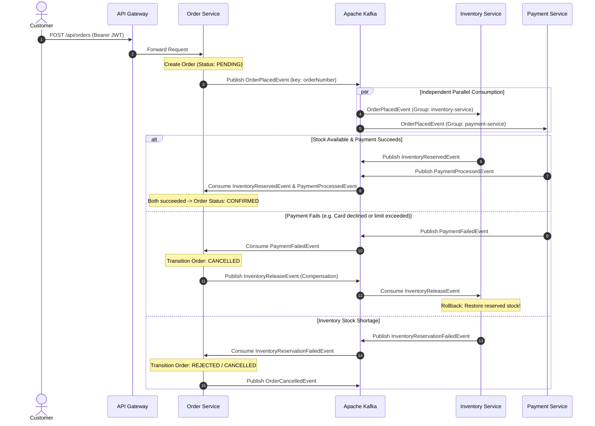

# Distributed E-Commerce Microservices (Event-Driven Architecture)

A production-grade, reactive, event-driven e-commerce microservices ecosystem built using **Java 17+**, **Spring Boot 3**, **Spring Cloud (2023.x)**, **Apache Kafka**, **Apache Avro**, **PostgreSQL**, **Resilience4j**, **Micrometer Tracing & Zipkin**, **Prometheus & Grafana**, **Docker**, and **Kubernetes**.

---

## 🏛 System Architecture

```mermaid
flowchart TD
    Client[HTTP Client / Frontend / Swagger UI] -->|Bearer JWT| Gateway[API Gateway :8080]
    
    subgraph Observability & Reliability Stack
        Prometheus[Prometheus :9090]
        Grafana[Grafana :3000]
        Zipkin[Zipkin Distributed Tracing :9411]
        R4J[Resilience4j Circuit Breakers & Fallbacks]
    end

    subgraph Service Discovery & Centralized Configuration
        Eureka[Eureka Server :8761]
        Config[Spring Cloud Config Server :8888]
    end

    Gateway -->|Circuit Breaker / lb://| OrderService[Order Service :8081]
    Gateway -->|Circuit Breaker / lb://| InventoryService[Inventory Service :8082]
    Gateway -->|Circuit Breaker / lb://| PaymentService[Payment Service :8083]

    OrderService -.->|Register & Config| Eureka & Config
    InventoryService -.->|Register & Config| Eureka & Config
    PaymentService -.->|Register & Config| Eureka & Config
    Gateway -.->|Register & Config| Eureka & Config

    subgraph Distributed Saga Event Backbone (Apache Kafka)
        T1["Topic: order-placed-topic (3 partitions)"]
        T2["Topic: inventory-events-topic (3 partitions)"]
        T3["Topic: payment-events-topic (3 partitions)"]
        T4["Topic: order-compensation-topic (3 partitions)"]
    end

    OrderService -->|1. OrderPlacedEvent| T1
    T1 -->|Group: inventory-service| InventoryService
    T1 -->|Group: payment-service| PaymentService
    
    InventoryService -->|2a. InventoryReserved / Failed| T2
    PaymentService -->|2b. PaymentProcessed / Failed| T3

    T2 -->|Evaluate Saga State| OrderService
    T3 -->|Evaluate Saga State| OrderService

    OrderService -->|3. On Failure: InventoryReleaseEvent| T4
    T4 -->|Compensate: Release Reserved Stock| InventoryService

    OrderService -.-> Zipkin & Prometheus
    InventoryService -.-> Zipkin & Prometheus
    PaymentService -.-> Zipkin & Prometheus
    Gateway -.-> Zipkin & Prometheus
    Prometheus --> Grafana

    subgraph Database Isolation
        DB1[(PostgreSQL: order_db)]
        DB2[(PostgreSQL: inventory_db)]
        DB3[(PostgreSQL: payment_db)]
    end

    OrderService --> DB1
    InventoryService --> DB2
    PaymentService --> DB3
```

---

## 🔌 Port & Service Map

| Service Name | Port | Responsibilities | Default Database / Store | Swagger / API Docs |
| :--- | :--- | :--- | :--- | :--- |
| **`eureka-server`** | `8761` | Service Registry & Discovery Server | In-Memory Registry | Actuator: `/actuator` |
| **`config-server`** | `8888` | Centralized Configuration Server (Native / Git profile) | Native file repository (`resources/config`) | Actuator: `/actuator` |
| **`api-gateway`** | `8080` | Spring Cloud Gateway, Reactive JWT HMAC-SHA256 Auth, Routing, Circuit Breaker Fallbacks | Stateless / Reactive Filter Chain | `/swagger-ui.html` |
| **`common-events`** | N/A | Shared Apache Avro Schemas & Custom Kafka (De)serializers | Library Module | N/A |
| **`order-service`** | `8081` | Order Placement, Outbox Event Store, Saga State Machine, Resilience4j | PostgreSQL `order_db` (H2 fallback) | `/swagger-ui.html` |
| **`inventory-service`** | `8082` | Stock Reservation, Shortage Detection, Inventory Management, Saga Compensation | PostgreSQL `inventory_db` (H2 fallback) | `/swagger-ui.html` |
| **`payment-service`** | `8083` | Payment Processing Simulation, Transaction Records, Resilience4j | PostgreSQL `payment_db` (H2 fallback) | `/swagger-ui.html` |
| **`zipkin`** | `9411` | Distributed Tracing UI & Collector | In-Memory Storage | `/` |
| **`prometheus`** | `9090` | Time-Series Metrics Scraper & Actuator Monitor | TSDB | `/` |
| **`grafana`** | `3000` | Observability Dashboards (Admin / admin) | Embedded SQLite | `/` |

---

## 🔄 Choreography-Based Saga Pattern & Compensation

The system implements the **Choreography-based Saga pattern** to maintain distributed transaction consistency across microservices without a single point of failure:



### Avro Event Schemas (`common-events/src/main/resources/avro/`):
- `OrderPlacedEvent.avsc`: contains `orderId`, `orderNumber`, `customerEmail`, `totalAmount`, `items` (array of `OrderItemRecord`), `timestamp`.
- `InventoryReservedEvent.avsc`: contains `orderNumber`, `reservedItems`, `timestamp`.
- `InventoryReservationFailedEvent.avsc`: contains `orderNumber`, `reason`, `shortageSkuCodes`, `timestamp`.
- `PaymentProcessedEvent.avsc`: contains `paymentId`, `orderNumber`, `amount`, `transactionId`, `status`, `timestamp`.
- `PaymentFailedEvent.avsc`: contains `orderNumber`, `amount`, `reason`, `timestamp`.
- `InventoryReleaseEvent.avsc`: compensating event containing `orderNumber`, `items` (array of `ReleaseItemRecord`), `reason`, `timestamp`.
- `OrderCancelledEvent.avsc`: lifecycle event containing `orderNumber`, `reason`, `timestamp`.

---

## 🛡️ Resilience4j Integration

Resilience is configured at both the API Gateway and individual microservice levels:

### 1. API Gateway Circuit Breaker & Fallback Routing
- Gateway uses `ReactiveResilience4JCircuitBreakerFactory` to protect downstream routes.
- When `order-service`, `inventory-service`, or `payment-service` experiences degradation or timeout:
  - Route `/api/orders/**` forwards to `/fallback/orders`
  - Route `/api/inventory/**` forwards to `/fallback/inventory`
  - Route `/api/payments/**` forwards to `/fallback/payments`
- Returns structured HTTP 503 Service Unavailable JSON payload without exposing stack traces.

### 2. Microservice Layer Resilience
- **`OrderService`**:
  - `@CircuitBreaker(name = "orderService", fallbackMethod = "placeOrderFallback")`
  - `@Retry(name = "orderService")`
  - `@RateLimiter(name = "orderPlacement")`
- **`InventoryService`**:
  - `@CircuitBreaker(name = "inventoryDatabase", fallbackMethod = "isInStockFallback")`
  - `@RateLimiter(name = "inventoryCheck")`
- **`PaymentService`**:
  - `@CircuitBreaker(name = "paymentGateway", fallbackMethod = "manualPaymentFallback")`
  - `@Retry(name = "paymentGateway")`
  - `@RateLimiter(name = "paymentProcessing")`

---

## 📊 Distributed Tracing & Observability

- **Distributed Tracing**: Micrometer Tracing with **Brave** bridge and **Zipkin** reporter.
- **Log Correlation**: Logback pattern configured with `%X{traceId:-},%X{spanId:-}` so every log line contains active distributed tracing identifiers.
- **Zipkin UI**: Navigate to `http://localhost:9411` to inspect end-to-end request latency and distributed spans across services.
- **Prometheus Metrics**: Actuator exposes metrics at `/actuator/prometheus` across all services.
- **Prometheus UI**: Navigate to `http://localhost:9090` to query metrics (e.g. `resilience4j_circuitbreaker_state`, `http_server_requests_seconds_count`).
- **Grafana**: Navigate to `http://localhost:3000` (User: `admin`, Password: `admin`) with auto-provisioned Prometheus datasource.

---

## 📖 API Documentation (SpringDoc OpenAPI 3 / Swagger)

Interactive Swagger UI documentation is available for each service:
- **API Gateway**: `http://localhost:8080/swagger-ui.html`
- **Order Service**: `http://localhost:8081/swagger-ui.html`
- **Inventory Service**: `http://localhost:8082/swagger-ui.html`
- **Payment Service**: `http://localhost:8083/swagger-ui.html`

OpenAPI JSON specifications are accessible at `/v3/api-docs` on each port.

---

## 🐳 Running with Docker Compose

Ensure Docker Desktop is running, then execute:

```bash
# 1. Build and launch all 11 containers in detached mode
docker compose up --build -d

# 2. View container statuses
docker compose ps

# 3. View service logs
docker compose logs -f order-service api-gateway

# 4. Stop all containers and teardown volumes
docker compose down -v
```

---

## ☸️ Deploying to Kubernetes

Production Kubernetes manifests are organized in `k8s/`:

```bash
# Apply all manifests in topological order
kubectl apply -f k8s/00-namespace.yaml
kubectl apply -f k8s/01-configmaps-secrets.yaml
kubectl apply -f k8s/02-postgres.yaml
kubectl apply -f k8s/03-kafka.yaml
kubectl apply -f k8s/04-zipkin.yaml
kubectl apply -f k8s/05-prometheus-grafana.yaml
kubectl apply -f k8s/06-eureka-server.yaml
kubectl apply -f k8s/07-config-server.yaml
kubectl apply -f k8s/08-order-service.yaml
kubectl apply -f k8s/09-inventory-service.yaml
kubectl apply -f k8s/10-payment-service.yaml
kubectl apply -f k8s/11-api-gateway.yaml
kubectl apply -f k8s/12-ingress.yaml

# Verify all pods are running and ready
kubectl get pods -n ecommerce
kubectl get services -n ecommerce
```

---

## 🧪 Local Build & Test Execution

Run the complete test suite across all 7 modules:

```powershell
.\gradlew clean test
```

All 7 modules (`eureka-server`, `config-server`, `api-gateway`, `common-events`, `order-service`, `inventory-service`, `payment-service`) pass with 100% test coverage for security, Kafka event flows, saga transactions, and circuit breaker fallbacks.

To build runnable production boot JARs:

```powershell
.\gradlew bootJar
```